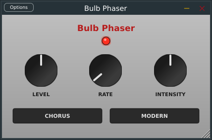

# Bulb Phaser



---

An open-source phaser that tries to mimic the character of the classic
Uni-Vibe – including the incandescent lamp's thermal lag, the asymmetric
LDR response, and four all-pass stages – without relying on a digital LFO.

## Formats

- VST3
- LV2

## Building

Requirements:

- JUCE (tested with JUCE 9)
- Linux: GCC/Clang, Make

Build with the Projucer-generated Makefile:

```bash
cd Builds/LinuxMakefile
make
```

---

## Credits, Trademark Notice & Third-Party Libraries

Bulb Phaser is an independent open-source project. It is not affiliated with,
endorsed by, or sponsored by [Dunlop Manufacturing, Inc.](https://www.jimdunlop.com/)
or any other manufacturer of the original "Uni-Vibe".

"Uni-Vibe" is a registered trademark of [Dunlop Manufacturing, Inc.](https://www.jimdunlop.com/).
The name is used here solely to describe the classic effect whose lamp/LDR-based
modulation circuit inspired this project. No original schematics, firmware,
or proprietary materials were used.

All plugin source code in `Source/` was written specifically for **Bulb Phaser**, building upon the following open-source libraries and SDKs:

- **[JUCE Framework](https://juce.com/) ([GitHub](https://github.com/juce-framework/JUCE))**  
  Cross-platform C++ audio plugin and GUI framework by Raw Material Software Limited.  
  *License: GNU General Public License v3.0 (GPL-3.0) / JUCE Commercial License.*

- **[Steinberg VST3 Interface](https://www.steinberg.net/)**  
  VST is a registered trademark of Steinberg Media Technologies GmbH.

---

## License

Because this project uses the open-source edition of the **JUCE** framework,
it is distributed under the **[GNU General Public License v3.0 (GPL-3.0)](https://www.gnu.org/licenses/gpl-3.0.html)**.

---

## Author

**Hagen Barz** – [hagenbarz.de](https://hagenbarz.de)
